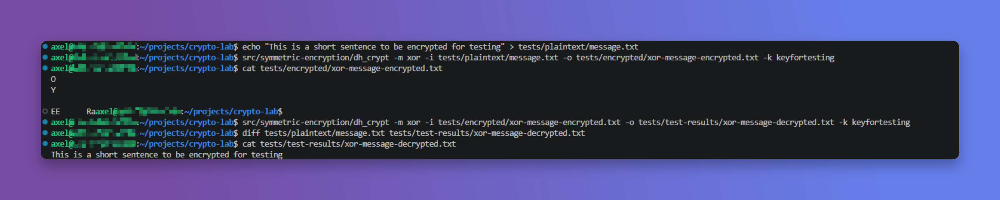
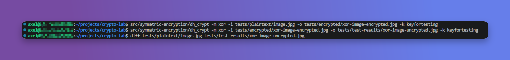
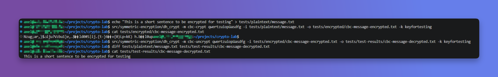
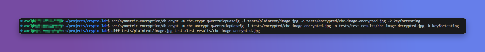
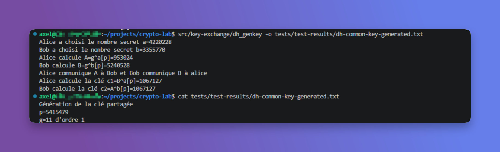
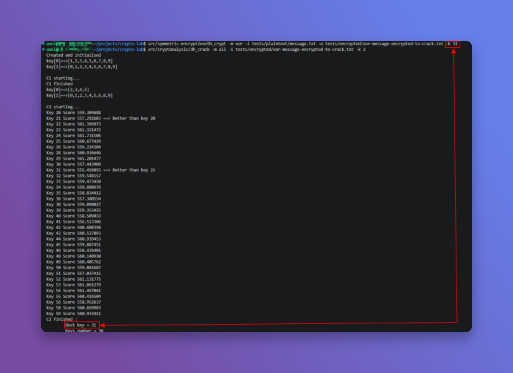

# CryptoLab

## :book: Overview

Implementation of cryptographic mechanisms in C covering symmetric encryption, Diffie-Hellman key exchange, and cryptanalysis techniques.

## :man_technologist: Skills Demonstrated

- C Programming
- Cryptography Fundamentals
- Cryptographic Protocol Design
- Algorithm Development
- Troubleshooting

## :camera: Screenshots

### Part 1 - Symmetric Encryption

#### XOR Message Encryption

Demonstration of message encryption using the XOR algorithm.

#### XOR Image Encryption

Demonstration of image encryption using the XOR algorithm.

#### CBC Message Encryption

Demonstration of message encryption using CBC mode.

#### CBC Image Encryption

Demonstration of image encryption using CBC mode.

### Part 2 - Diffie-Hellman Key Exchange

Generation of a shared secret key using the Diffie-Hellman protocol.

### Part 3 - Cryptanalysis

Recovery of the XOR encryption key through cryptanalysis techniques.

## :gear: Technologies

- C
- Linux
- GCC
- Standard C Library

## :closed_lock_with_key: Features

- XOR Encryption & Decryption
- CBC Encryption & Decryption
- Diffie-Hellman Key Exchange
- Key Recovery through Cryptanalysis
- File Encryption
- Image Encryption

## :books: Documentation

Additional project documentation, including the project specification, planning deliverables, and lessons learned, is available in the /docs folder.